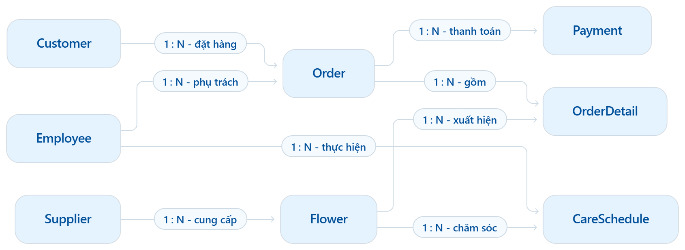

# Hệ thống quản lý cửa hàng bán hoa

## Mô tả

Một cửa hàng bán hoa chuyên kinh doanh nhiều loại hoa và phục vụ nhu cầu mua hoa trực tiếp hoặc đặt giao đến địa chỉ của khách hàng. Để quản lý hoạt động kinh doanh, cửa hàng lưu trữ thông tin về khách hàng, nhà cung cấp, nhân viên, các loại hoa, đơn hàng, thanh toán và quá trình chăm sóc hoa.

Cửa hàng có nhiều nhân viên, mỗi nhân viên được phân biệt bằng mã nhân viên và có các thông tin như họ tên, chức vụ, số điện thoại và mức lương. Nhân viên có thể được phân công phụ trách các đơn hàng của khách hàng cũng như thực hiện việc kiểm tra, chăm sóc hoa trong cửa hàng.

Cửa hàng nhập hoa từ nhiều nhà cung cấp. Mỗi nhà cung cấp được phân biệt bằng mã nhà cung cấp và có các thông tin như tên nhà cung cấp, số điện thoại, địa chỉ và người đại diện. Một nhà cung cấp có thể cung cấp nhiều loại hoa, trong khi mỗi loại hoa được quản lý thuộc về một nhà cung cấp. Mỗi loại hoa được phân biệt bằng mã hoa và có các thông tin như tên hoa, loại hoa, màu sắc, đơn giá và số lượng tồn kho.

Khách hàng khi mua hoặc đặt hoa sẽ được lưu thông tin gồm mã khách hàng, họ tên, số điện thoại, địa chỉ và email. Một khách hàng có thể thực hiện nhiều đơn hàng theo thời gian, nhưng mỗi đơn hàng chỉ thuộc về một khách hàng. Mỗi đơn hàng được phân biệt bằng mã đơn hàng và ghi nhận ngày đặt hàng, ngày giao hàng, địa chỉ giao hàng và trạng thái đơn hàng. Mỗi đơn hàng do một nhân viên phụ trách và có thể bao gồm nhiều loại hoa khác nhau.

Đối với mỗi loại hoa được lựa chọn trong một đơn hàng, cửa hàng ghi nhận một chi tiết đơn hàng gồm loại hoa, số lượng và đơn giá tại thời điểm bán. Một loại hoa có thể xuất hiện trong nhiều đơn hàng khác nhau. Đơn giá được ghi nhận tại thời điểm bán nhằm đảm bảo giá trị của các đơn hàng trong quá khứ không bị thay đổi khi giá hoa hiện tại được cập nhật.

Mỗi đơn hàng có thể được thanh toán một hoặc nhiều lần. Thông tin thanh toán được lưu trữ riêng, bao gồm mã thanh toán, đơn hàng tương ứng, số tiền thanh toán, phương thức thanh toán (tiền mặt, chuyển khoản, ví điện tử…), ngày thanh toán và trạng thái thanh toán. Một đơn hàng có thể có nhiều lần thanh toán, trong khi mỗi lần thanh toán chỉ thuộc về một đơn hàng.

Bên cạnh hoạt động bán hàng, cửa hàng thường xuyên kiểm tra và chăm sóc hoa nhằm duy trì chất lượng sản phẩm trong kho. Mỗi lần chăm sóc được ghi nhận bằng một lịch chăm sóc, bao gồm mã chăm sóc, loại hoa được kiểm tra, nhân viên thực hiện, ngày kiểm tra, mức độ tươi của hoa, tình trạng nước, hành động đã thực hiện và ghi chú. Một loại hoa có thể được kiểm tra và chăm sóc nhiều lần bởi các nhân viên khác nhau trong những thời điểm khác nhau, trong khi mỗi lần chăm sóc chỉ do một nhân viên thực hiện.

---

## 1. Thực thể và thuộc tính

### Customer

| Thuộc tính   | Mô tả             | Ghi chú |
|--------------|-------------------|---------|
| customer_id  | Mã khách hàng     | **PK**  |
| name         | Tên khách hàng    |         |
| phone        | Số điện thoại     |         |
| address      | Địa chỉ giao hàng |         |
| email        | Thư điện tử       |         |

### Supplier

| Thuộc tính     | Mô tả                       | Ghi chú |
|----------------|-----------------------------|---------|
| supplier_id    | Mã nhà cung cấp             | **PK**  |
| name           | Tên nhà cung cấp / vườn hoa |         |
| phone          | Số điện thoại liên hệ       |         |
| address        | Địa chỉ nhà cung cấp        |         |
| representative | Người đại diện              |         |

### Employee

| Thuộc tính  | Mô tả                                            | Ghi chú |
|-------------|--------------------------------------------------|---------|
| employee_id | Mã nhân viên                                     | **PK**  |
| name        | Tên nhân viên                                    |         |
| role        | Chức vụ (thợ cắm hoa, chăm sóc kho, bán hàng...) |         |
| phone       | Số điện thoại                                    |         |
| salary      | Lương cơ bản                                     |         |

### Flower

| Thuộc tính     | Mô tả                                           | Ghi chú           |
|----------------|-------------------------------------------------|-------------------|
| flower_id      | Mã hoa / sản phẩm                               | **PK**            |
| name           | Tên hoa hoặc tên sản phẩm                       |                   |
| category       | Danh mục (hoa lẻ, bó hoa, giỏ hoa, vòng hoa...) |                   |
| unit_price     | Đơn giá bán                                     |                   |
| stock_quantity | Số lượng tồn kho hiện tại                       |                   |
| color          | Màu sắc chủ đạo                                 |                   |
| supplier_id    | Mã nhà cung cấp                                 | **FK → Supplier** |

### Order

| Thuộc tính       | Mô tả                                                | Ghi chú           |
|------------------|------------------------------------------------------|-------------------|
| order_id         | Mã đơn hàng                                          | **PK**            |
| customer_id      | Mã khách hàng                                        | **FK → Customer** |
| employee_id      | Mã nhân viên phụ trách                               | **FK → Employee** |
| order_date       | Ngày giờ đặt hàng                                    |                   |
| delivery_date    | Ngày giờ hẹn giao hoa                                |                   |
| delivery_address | Địa chỉ người nhận                                   |                   |
| order_status     | Trạng thái đơn hàng (đang xử lý, đang giao, hoàn thành, hủy) |                   |

### OrderDetail

| Thuộc tính         | Mô tả                     | Ghi chú             |
|--------------------|---------------------------|---------------------|
| order_id           | Mã đơn hàng               | **PK, FK → Order**  |
| flower_id          | Mã hoa                    | **PK, FK → Flower** |
| quantity           | Số lượng mua              |                     |
| unit_price_at_sale | Đơn giá tại thời điểm bán |                     |

> **Lưu ý:** OrderDetail là thực thể yếu (weak entity). Khóa chính là khóa phức hợp `(order_id, flower_id)`.

### Payment

| Thuộc tính     | Mô tả                                      | Ghi chú        |
|----------------|--------------------------------------------|---------------|
| payment_id     | Mã thanh toán                              | **PK**        |
| order_id       | Mã đơn hàng                                | **FK → Order**|
| amount         | Số tiền thanh toán                         |               |
| payment_method | Phương thức thanh toán (tiền mặt, chuyển khoản, ví điện tử...) |               |
| payment_date   | Ngày thanh toán                            |               |
| payment_status | Trạng thái thanh toán (chưa thanh toán, đã thanh toán, thất bại, hoàn tiền) |               |

### CareSchedule

| Thuộc tính      | Mô tả                                              | Ghi chú           |
|-----------------|----------------------------------------------------|-------------------|
| care_id         | Mã lịch chăm sóc                                   | **PK**            |
| flower_id       | Mã hoa cần chăm sóc                                | **FK → Flower**   |
| employee_id     | Mã nhân viên phụ trách                             | **FK → Employee** |
| check_date      | Ngày giờ kiểm tra                                  |                   |
| freshness_level | Độ tươi (tươi, hơi héo, hỏng)                      |                   |
| water_status    | Tình trạng nước / độ ẩm (cần thay nước, đã tưới)   |                   |
| action_taken    | Hành động xử lý (cắt gốc, phun sương, tiêu hủy...) |                   |
| note            | Ghi chú thêm về tình trạng bảo quản                |                   |

---

## 2. Mối quan hệ (Relationships)

| Relationship              | Cardinality | Mô tả                                                                                                     |
|---------------------------|-------------|-----------------------------------------------------------------------------------------------------------|
| Customer – Order          | 1 : N       | Một khách hàng có thể có nhiều đơn hàng. Một đơn hàng chỉ thuộc về một khách hàng.                        |
| Employee – Order          | 1 : N       | Một nhân viên có thể phụ trách nhiều đơn hàng. Một đơn hàng chỉ do một nhân viên phụ trách.               |
| Supplier – Flower         | 1 : N       | Một nhà cung cấp cung cấp nhiều loại hoa. Một loại hoa chỉ đến từ một nhà cung cấp.                       |
| Order – OrderDetail       | 1 : N       | Một đơn hàng có nhiều chi tiết (nhiều loại hoa). Mỗi chi tiết chỉ thuộc về một đơn hàng.                  |
| Flower – OrderDetail      | 1 : N       | Một loại hoa có thể xuất hiện trong nhiều chi tiết đơn hàng. Mỗi chi tiết chỉ liên quan đến một loại hoa. |
| Order – Payment           | 1 : N       | Một đơn hàng có thể có nhiều lần thanh toán. Mỗi lần thanh toán chỉ thuộc về một đơn hàng.               |
| Flower – CareSchedule     | 1 : N       | Một loại hoa có thể có nhiều lịch chăm sóc. Mỗi lịch chăm sóc chỉ dành cho một loại hoa.                  |
| Employee – CareSchedule   | 1 : N       | Một nhân viên có thể thực hiện nhiều lịch chăm sóc. Mỗi lịch chăm sóc chỉ do một nhân viên thực hiện.     |

---

## 3. Sơ đồ quan hệ


## 4. Class Java : Customer, Supplier, Employee, Flower, Order, OrderDetail, CareSchedule. 
                       
## 1. `Customer`

ERD định nghĩa `customer_id`, `name`, `phone`, `address`, `email`. 

```java
public class Customer {

    private String customerId;
    private String name;
    private String phone;
    private String address;
    private String email;

}
```

| Attribute    | Java type | Ý nghĩa        |
| ------------ | --------- | -------------- |
| `customerId` | `String`  | Mã khách hàng  |
| `name`       | `String`  | Tên khách hàng |
| `phone`      | `String`  | Số điện thoại  |
| `address`    | `String`  | Địa chỉ        |
| `email`      | `String`  | Email          |

---

## 3. `Supplier`

ERD định nghĩa `supplier_id`, `name`, `phone`, `address`, `representative`. 

```java
public class Supplier {

    private String supplierId;
    private String name;
    private String phone;
    private String address;
    private String representative;

}
```

| Attribute        | Java type | Ý nghĩa          |
| ---------------- | --------- | ---------------- |
| `supplierId`     | `String`  | Mã nhà cung cấp  |
| `name`           | `String`  | Tên nhà cung cấp |
| `phone`          | `String`  | Số điện thoại    |
| `address`        | `String`  | Địa chỉ          |
| `representative` | `String`  | Người đại diện   |

---

## 4. `Employee`

ERD định nghĩa `employee_id`, `name`, `role`, `phone`, `salary`. 

```java
import java.math.BigDecimal;

public class Employee {

    private String employeeId;
    private String name;
    private String role;
    private String phone;
    private BigDecimal salary;

}
```

| Attribute    | Java type    | Ý nghĩa          |
| ------------ | ------------ | ---------------- |
| `employeeId` | `String`     | Mã nhân viên     |
| `name`       | `String`     | Tên nhân viên    |
| `role`       | `String`     | Vị trí / chức vụ |
| `phone`      | `String`     | Số điện thoại    |
| `salary`     | `BigDecimal` | Lương            |

---

## 5. `Flower`

ERD định nghĩa `flower_id`, `name`, `category`, `unit_price`, `stock_quantity`, `color`, `supplier_id`. 

```java
import java.math.BigDecimal;

public class Flower {

    private String flowerId;
    private String name;
    private String category;
    private BigDecimal unitPrice;
    private int stockQuantity;
    private String color;
    private String supplierId;

}
```

| Attribute       | Java type    | Ý nghĩa              |
| --------------- | ------------ | -------------------- |
| `flowerId`      | `String`     | Mã hoa               |
| `name`          | `String`     | Tên hoa              |
| `category`      | `String`     | Danh mục             |
| `unitPrice`     | `BigDecimal` | Đơn giá bán          |
| `stockQuantity` | `int`        | Số lượng tồn kho     |
| `color`         | `String`     | Màu sắc              |
| `supplierId`    | `String`     | Mã nhà cung cấp — FK |

---

## 6. `Order`

ERD định nghĩa `order_id`, `customer_id`, `employee_id`, `order_date`, `delivery_date`, `delivery_address`, `status`. 

```java
import java.time.LocalDateTime;

public class Order {

    private String orderId;
    private String customerId;
    private String employeeId;
    private LocalDateTime orderDate;
    private LocalDateTime deliveryDate;
    private String deliveryAddress;
    private String status;

}
```

| Attribute         | Java type       | Ý nghĩa            |
| ----------------- | --------------- | ------------------ |
| `orderId`         | `String`        | Mã đơn hàng        |
| `customerId`      | `String`        | Mã khách hàng — FK |
| `employeeId`      | `String`        | Mã nhân viên — FK  |
| `orderDate`       | `LocalDateTime` | Ngày đặt           |
| `deliveryDate`    | `LocalDateTime` | Ngày giao          |
| `deliveryAddress` | `String`        | Địa chỉ giao       |
| `status`          | `String`        | Trạng thái         |

---

## 7. `OrderDetail`

Đây là entity trung gian giữa `Order` và `Flower`, có khóa chính kép `order_id + flower_id`. 

```java
import java.math.BigDecimal;

public class OrderDetail {

    private String orderId;
    private String flowerId;
    private int quantity;
    private BigDecimal unitPriceAtSale;

}
```

| Attribute         | Java type    | Ý nghĩa                   |
| ----------------- | ------------ | ------------------------- |
| `orderId`         | `String`     | Mã đơn hàng — PK, FK      |
| `flowerId`        | `String`     | Mã hoa — PK, FK           |
| `quantity`        | `int`        | Số lượng mua              |
| `unitPriceAtSale` | `BigDecimal` | Đơn giá tại thời điểm bán |

---

## 8. `CareSchedule`

ERD định nghĩa `care_id`, `flower_id`, `employee_id`, `check_date`, `freshness_level`, `water_status`, `action_taken`, `note`. 

```java
import java.time.LocalDateTime;

public class CareSchedule {

    private String careId;
    private String flowerId;
    private String employeeId;
    private LocalDateTime checkDate;
    private String freshnessLevel;
    private String waterStatus;
    private String actionTaken;
    private String note;

}
```

| Attribute        | Java type       | Ý nghĩa           |
| ---------------- | --------------- | ----------------- |
| `careId`         | `String`        | Mã lịch chăm sóc  |
| `flowerId`       | `String`        | Mã hoa — FK       |
| `employeeId`     | `String`        | Mã nhân viên — FK |
| `checkDate`      | `LocalDateTime` | Ngày kiểm tra     |
| `freshnessLevel` | `String`        | Độ tươi           |
| `waterStatus`    | `String`        | Tình trạng nước   |
| `actionTaken`    | `String`        | Hành động xử lý   |
| `note`           | `String`        | Ghi chú           |

---

### 9. Tổng hợp cấu trúc Java

| Entity         | Số thuộc tính | PK                   | FK                         |
| -------------- | ------------: | -------------------- | -------------------------- |
| `Customer`     |             5 | `customerId`         | —                          |
| `Supplier`     |             5 | `supplierId`         | —                          |
| `Employee`     |             5 | `employeeId`         | —                          |
| `Flower`       |             7 | `flowerId`           | `supplierId`               |
| `Order`        |             7 | `orderId`            | `customerId`, `employeeId` |
| `OrderDetail`  |             4 | `orderId + flowerId` | `orderId`, `flowerId`      |
| `CareSchedule` |             8 | `careId`             | `flowerId`, `employeeId`   |

## 5 Các câu truy vấn

01. Kiểm tra kho (các loại hoa có số lượng <10)
02. Truy vấn các hóa đơn được thanh toán bằng phương thức chuyển khoản
03. Xuất danh sách các loại hoa có từ ABC đang có sẵn trong cửa hàng (Ví dụ Tìm các loài hoa có từ “Nhài”)
04. Xuất danh sách các hóa đơn có giá trị cao (>500.000VND)
05. Search thông tin của hoa khi biết được mã hoa 
06. Xuất danh sách các loại hoa có giá bán trong khoảng A đến B (ví dụ Xuất danh sách các loại hoa có giá bán nằm trong khoảng từ 100.000VND đến 1.000.000VND)
07. Search các loại hoa đang hot trong cửa hàng (được bán nhiều nhất)
08. Xuất danh sách các loài hoa có màu A (Ví dụ Xuất danh sách các loại hoa có màu lam)
09. Kiểm tra các loại hoa đã tồn kho quá lâu (quá 7 ngày) để loại bỏ
10. Xuất danh sách các loại hoa theo giá bán giảm dần 
11. Truy xuất các đơn hàng chưa giao thành công trong hôm nay
12. Xuất một danh sách các loại hoa có doanh số bán thấp nhất của cửa hàng
13. Tổng số tiền nhập hàng của các nhà cung cung cấp
14. Tổng doanh thu của cửa hàng trong ngày hôm nay
15. Xuất danh sách các khách hàng đã từng đặt hàng tại cửa hàng.
16. Xuất danh sách các khách hàng chưa từng đặt hàng.
17. Tìm khách hàng có số lượng đơn hàng nhiều nhất.
18. Xuất danh sách các nhân viên đang phụ trách đơn hàng.
19. Tìm nhân viên phụ trách nhiều đơn hàng nhất.
20. Xuất danh sách các nhà cung cấp đang cung cấp hoa cho cửa hàng.
21. Tìm nhà cung cấp đang cung cấp nhiều loại hoa nhất.
22. Thống kê số lượng các loại hoa theo từng nhà cung cấp.
23. Thống kê tổng số lượng hoa đã được bán theo từng loại hoa.
24. Tính tổng số tiền mà mỗi khách hàng đã chi tiêu tại cửa hàng.
25. Xuất danh sách các đơn hàng của một khách hàng khi biết mã khách hàng.
26. Xuất chi tiết một đơn hàng khi biết mã đơn hàng, bao gồm tên hoa, số lượng mua và đơn giá tại thời điểm bán.
27. Tìm các đơn hàng có số lượng loại hoa khác nhau từ 3 loại trở lên.
28. Xuất danh sách các loại hoa chưa từng xuất hiện trong bất kỳ đơn hàng nào.
29. Thống kê số lượng đơn hàng theo từng trạng thái.
30. Xuất danh sách các lịch chăm sóc hoa do một nhân viên thực hiện, bao gồm ngày kiểm tra, độ tươi, tình trạng nước và hành động xử lý.


#6 Dữ liệu mẫu cho các thực thể

## 6.1 Customer

```sql
INSERT INTO Customer (customer_id, name, phone, address, email) VALUES
('KH001', N'Nguyễn Văn An', '0901234567', N'Phường Phước Long B, TP. Thủ Đức', 'an.nguyen@gmail.com'),
('KH002', N'Trần Thị Bích', '0912345678',  N'Quận 1, TP.HCM', NULL),
('KH003', N'Lê Hoàng Nam', '0983334444', N'Phường Dĩ An, TP. Dĩ An', 'nam.le@gmail.com'),
('KH004', N'Phạm Thu Thảo', '0978889999', N'Phường Bến Nghé, Quận 1', 'thao.pham@gmail.com'),
('KH005', N'Vũ Quốc Anh', '0934567890', N'Phường Hiệp Phú, TP. Thủ Đức',  NULL),
('KH006', N'Nguyễn Văn An', '0901234567', N'Phường Phước Long B, TP. Thủ Đức, TP.HCM', 'an.nguyen@gmail.com'),
('KH007', N'Trần Thị Bích', '0912345678', N'Phường Bến Nghé, Quận 1, TP.HCM', NULL),
('KH008', N'Lê Hoàng Nam', '0983334444', N'Phường Dĩ An, TP. Dĩ An, Bình Dương', 'nam.le@gmail.com'),
('KH009', N'Phạm Thu Thảo', '0978889999', N'Phường Linh Trung, TP. Thủ Đức, TP.HCM', 'thao.pham@gmail.com'),
('KH010', N'Vũ Quốc Anh', '0934567890', N'Phường Hiệp Phú, TP. Thủ Đức, TP.HCM', NULL),
('KH011', N'Đỗ Minh Trí', '0965554433', N'Phường Linh Trung, TP. Thủ Đức, TP.HCM', 'tri.do@gmail.com'),
('KH012', N'Ngô Thanh Vân', '0941112233', N'Quận 7, TP.HCM', NULL),
('KH013', N'Bùi Tiến Dũng', '0908887766', N'Thành phố Dĩ An, Bình Dương', 'tiendung@gmail.com');
```
## 6.2 Supplier
```sql
INSERT INTO NhaCungCap (MaNCC, TenNCC, SDT, DiaChi, NguoiDaiDien) VALUES
('NCC01', N'Vườn Hoa Đà Lạt Farm', '0633123456', N'Phường 11, TP. Đà Lạt, Lâm Đồng', N'Nguyễn Thị Kiều'),
('NCC02', N'Hoa Tươi Miền Tây Co.', '02923888999', N'Quận Ninh Kiều, Cần Thơ', N'Trần Thị Hoa'),
('NCC03', N'Công ty Hoa Nhập Khẩu Sapa', '02143777888', N'Thị xã Sa Pa, Lào Cai', N'Phan Văn Hiền'),
('NCC04', N'Nông trại Hoa Hướng Dương Bình Dương', '02743555666', N'TP. Dĩ An, Bình Dương', N'Huỳnh Văn Thiện');
```
## 6.3 Employee
```sql
INSERT INTO NhanVien (MaNV, TenNV, VaiTro, SDT, Luong) VALUES
('NV01', N'Văn Đạt', N'Nhân Viên Giao Hàng', '0234567896', 100000),
('NV02', N'Kim Duyên', N'Thu Ngân', '0456789345', 150000),
('NV03', N'Thị Hương', N'Nhân Viên Chăm Sóc Hoa', '0987654356', 120000),
('NV04', N'Minh Hoa', N'Nhân Viên Chăm Sóc Hoa', '0867444566', 110000),
('NV05', N'Văn Thành', N'Nhân Viên Kho', '0857676767', 140000),
('NV06', N'Văn Thanh', N'Nhân Viên Cắm Hoa', '0576768979', 150000),
('NV07', N'Ngọc Hân', N'Nhân Viên Cắm Hoa', '0984757456', 150000),
('NV08', N'Kim Ngọc', N'Nhân Viên Thu Ngân', '09845677776', 130000);
```
## 6.4 Flower
```sql
INSERT INTO Flower (flower_id, name, category, unit_price, stock_quantity, color, supplier_id) VALUES
('FL01', N'Bó Hoa Hồng Đỏ Cổ Điển', N'Hoa Hồng', 250000, 35, N'Đỏ', 'NCC01'),
('FL02', N'Bó Hoa Hồng Vàng Ấm Áp', N'Hoa Hồng', 220000, 3, N'Vàng', 'NCC01'),
('FL03', N'Lẵng Hoa Cúc Tơ Trắng', N'Hoa Cúc', 180000, 8, N'Trắng', 'NCC02'),
('FL04', N'Chậu Lan Hồ Điệp 3 Nhánh', N'Hoa Lan', 1200000, 5, N'Tím', 'NCC03'),
('FL05', N'Bó Hoa Hướng Dương Rực Rỡ', N'Hoa Hướng Dương', 300000, 18, N'Vàng', 'NCC04'),
('FL06', N'Bó Hoa Baby Trắng Tinh Khôi', N'Hoa Baby', 320000, 20, N'Trắng', 'NCC05'),
('FL07', N'Bó Hoa Tulip Hà Lan Đỏ', N'Hoa Tulip', 650000, 6, N'Đỏ', 'NCC05'),
('FL08', N'Lẵng Hoa Sen Quan Âm Cao Cấp', N'Hoa Sen', 450000, 4, N'Hồng', 'NCC06');

```

## 6.5 Order
```sql
INSERT INTO Order (order_id, customer_id, employee_id, order_date, delivery_date, delivery_address, order_status) VALUES
('ORD001', 'KH01', 'NV01', '2026-09-25 08:30:00', '2026-09-25 10:00:00', N'Phường Phước Long B, TP. Thủ Đức', N'HOAN_THANH'),
('ORD002', 'KH02', 'NV01', '2026-09-26 14:15:00', '2026-09-26 16:30:00', N'Phường Bến Nghé, Quận 1, TP.HCM', N'HOAN_THANH'),
('ORD003', 'KH03', 'NV02', '2026-09-28 09:00:00', '2026-09-28 11:00:00', N'Phường Dĩ An, TP. Dĩ An, Bình Dương', N'HOAN_THANH'),
('ORD004', 'KH04', 'NV01', '2026-09-30 10:20:00', '2026-09-30 14:00:00', N'Phường Linh Trung, TP. Thủ Đức', N'HOAN_THANH'),
('ORD005', 'KH01', 'NV01', '2026-10-01 08:10:00', '2026-10-01 10:30:00', N'Phường Phước Long B, TP. Thủ Đức', N'DANG_GIAO'),
('ORD006', 'KH05', 'NV01', '2026-10-01 08:40:00', '2026-10-01 15:00:00', N'Phường Hiệp Phú, TP. Thủ Đức', N'CHO_XAC_NHAN'),
('ORD007', 'KH02', 'NV01', '2026-09-29 11:15:00', '2026-09-29 14:00:00', N'Quận 1, TP.HCM', N'HOAN_THANH'),
('ORD008', 'KH03', 'NV02', '2026-09-30 16:20:00', '2026-09-30 18:00:00', N'Thành phố Dĩ An, Bình Dương', N'DA_HUY'),
('ORD009', 'KH04', 'NV03', '2026-10-01 07:30:00', '2026-10-01 09:30:00', N'Phường Bến Nghé, Quận 1', N'HOAN_THANH'),
('ORD010', 'KH05', 'NV01', '2026-10-01 09:10:00', '2026-10-01 11:00:00', N'Phường Hiệp Phú, TP. Thủ Đức', N'DANG_XU_LY');
```

## 6.6 OrderDetail
```sql
INSERT INTO OrderDetail (order_id, flower_id, quantity, unit_price_at_sale) VALUES
('ORD001', 'FL01', 2, 250000),
('ORD002', 'FL04', 1, 1200000),
('ORD003', 'FL05', 1, 300000),
('ORD004', 'FL07', 1, 650000),
('ORD004', 'FL06', 1, 320000),
('ORD005', 'FL01', 1, 250000),
('ORD006', 'FL04', 1, 1200000),
('ORD007', 'FL11', 1, 2100000),
('ORD008', 'FL10', 2, 350000),
('ORD009', 'FL14', 1, 280000),
('ORD009', 'FL09', 1, 190000),
('ORD010', 'FL13', 1, 850000);
```

## 6.7 Payment
```sql
INSERT INTO Payment (payment_id, order_id, amount, payment_method, payment_date, payment_status) VALUES
('P001', 'ORD001', 500000, N'TIEN_MAT', '2026-09-25 08:35:00', N'THANH_TOAN_THANH_CONG'),
('P002', 'ORD002', 1200000, N'CHUYEN_KHOAN', '2026-09-26 14:20:00', N'THANH_TOAN_THANH_CONG'),
('P003', 'ORD003', 300000, N'MOMO', '2026-09-28 09:05:00', N'THANH_TOAN_THANH_CONG'),
('P004', 'ORD004', 970000, N'VNPAY', '2026-09-30 10:25:00', N'THANH_TOAN_THANH_CONG'),
('P005', 'ORD005', 250000, N'TIEN_MAT', '2026-10-01 08:12:00', N'THANH_TOAN_THANH_CONG'),
('P006', 'ORD006', 1200000, N'CHUYEN_KHOAN', NULL, N'CHO_THANH_TOAN'),
('P007', 'ORD007', 2100000, N'CHUYEN_KHOAN', '2026-09-29 11:20:00', N'THANH_TOAN_THANH_CONG'),
('P008', 'ORD008', 700000, N'MOMO', '2026-09-30 16:22:00', N'DA_HOAN_TIEN'),
('P009', 'ORD009', 470000, N'VNPAY', '2026-10-01 07:32:00', N'THANH_TOAN_THANH_CONG'),
('P010', 'ORD010', 850000, N'CHUYEN_KHOAN', NULL, N'CHO_THANH_TOAN');
```
## 6.8 CareSchedule
```sql
INSERT INTO CareSchedule (care_id, flower_id, employee_id, check_date, freshness_level, water_status, action_taken, note) VALUES
('CS001', 'FL01', 'NV03', '2026-09-29 07:00:00', N'Tươi tốt (100%)', N'Đủ nước', N'Phun sương, thay nước dưỡng hoa', N'Hoa mới nhập, cành khỏe'),
('CS002', 'FL02', 'NV03', '2026-09-30 07:30:00', N'Khá tươi (80%)', N'Thiếu nhẹ', N'Thêm chất dinh dưỡng, tỉa bớt lá chân', N'Hoa nhập ngày 22/09, cần đẩy mạnh bán trước'),
('CS003', 'FL03', 'NV04', '2026-09-30 08:00:00', N'Trung bình (60%)', N'Đủ nước', N'Tỉa cánh hoa héo, hạ giá niêm yết', N'Lẵng cúc nhập lâu, cân nhắc thanh lý'),
('CS004', 'FL04', 'NV04', '2026-10-01 07:00:00', N'Rất tốt (95%)', N'Ẩm vừa đủ', N'Lau lá, kiểm tra rễ chậu lan', N'Đang nở đẹp, để khu vực trưng bày chính'),
('CS005', 'FL08', 'NV04', '2026-10-01 07:15:00', N'Khá tươi (75%)', N'Đủ nước', N'Thay nước bình, bọc lại chân cành', N'Chờ giao cho khách đặt trước'),
('CS006', 'FL09', 'NV03', '2026-10-01 08:30:00', N'Rất tốt (98%)', N'Đủ nước', N'Thay nước mới, kiểm tra độ nở', N'Hoa mới về sáng nay'),
('CS007', 'FL10', 'NV04', '2026-10-01 08:45:00', N'Tươi tốt (90%)', N'Đủ nước', N'Tỉa lá gãy, xịt phun sương', N'Đặt ở kệ trưng bày số 2'),
('CS008', 'FL11', 'NV04', '2026-10-01 09:00:00', N'Rất tốt (100%)', N'Ẩm vừa đủ', N'Vệ sinh chậu sứ, kiểm tra ngọn', N'Hàng VIP cho khách doanh nghiệp'),
('CS009', 'FL14', 'NV03', '2026-10-01 09:15:00', N'Tươi tốt (95%)', N'Đủ nước', N'Cắt gốc 1cm, ngâm dung dịch dưỡng', N'Sẵn sàng đóng bó giao khách');
``` 